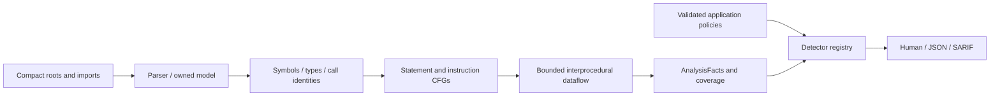

# Nightshade architecture

Nightshade analyzes Compact source through an owned model; detectors share facts
rather than reimplementing language semantics.

`src/parser` owns the pinned tree-sitter grammar and translates concrete nodes
into `src/model.ts`. Other layers never inspect grammar kinds. `src/semantic`
resolves scopes, canonical types, module instances and calls against a selected
compiler profile. Physical source caches do not collapse semantic module identities.

The default engine uses `Program.instructionCFG`, preserving expression order,
short-circuit control and abort edges. `src/dataflow` tracks abstract values,
private provenance, ledger revisions, guards and effects along bounded histories.
Pure, read-only and supported stateful transfer summaries reduce repeated work;
reference-engine and cached/uncached tests check equivalence. Unknown effects and
budget exhaustion produce coverage diagnostics.

Detectors consume `AnalysisFacts`, with explicit policies where intent is needed.
Reporting keeps severity, confidence, source spans, traces and incompleteness
separate. CLI scans use supervised workers; normal scans are offline. UTF-8 byte
offsets and UTF-16 display/SARIF columns retain source identity.

The package exports analysis and detector APIs under the compatibility name
`nightshade-compact`. Auditor printers expose inventory, ledger access, disclosure and
data dependencies. There is no SMT solver or general symbolic executor.
See [limitations](limitations.md), the [ADRs](adr/0002-expression-effects-and-isolation.md)
.
